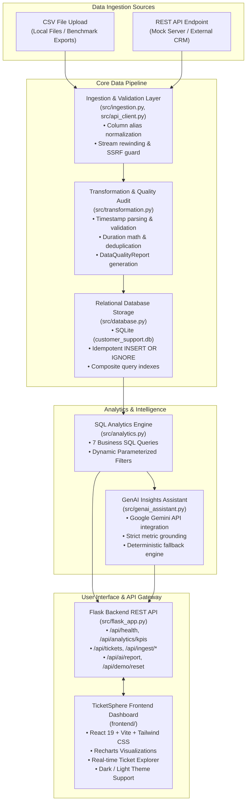

# TicketSphere

**Customer Support Ticket Analytics & GenAI Business Assistant**

TicketSphere is an enterprise-grade customer support analytics platform and AI assistant. It integrates dual-channel data ingestion (CSV file uploads and live REST APIs), automated schema normalization, deterministic data transformation, idempotent relational storage in SQLite, parameterized SQL analytics, and an interactive executive dashboard powered by React 19, Tailwind CSS, and Recharts.

The platform also includes a strictly grounded GenAI Insights Assistant powered by Google Gemini (with an honest deterministic analytical fallback) that translates raw database metrics into actionable operational recommendations without hallucinations.

---

## Architecture & Data Flow



---

## Key Features

1. **Dual-Channel Data Ingestion:**
   - **CSV Ingestion:** Drag-and-drop CSV file uploader with automated column alias mapping (supports exports from Zendesk, Salesforce, Freshdesk, Kaggle, and ExploreMyData), encoding detection (UTF-8, UTF-8 with BOM, Latin-1), and stream rewinding.
   - **REST API Ingestion:** Built-in HTTP client with timeout handling, optional header authentication (`X-API-Key`), SSRF validation, and a local simulated FastAPI mock support server (`src/mock_api.py`).

2. **Automated Data Transformation & Quality Audit:**
   - Standardizes status, priority, and complaint categories into a unified relational schema.
   - Computes exact resolution duration (`resolution_time_hours`) strictly for resolved/closed tickets, safely clearing false timestamps on open tickets.
   - Generates an instant, structured `DataQualityReport` tracking total received, accepted, rejected, and duplicate records.

3. **Idempotent Relational Storage (SQLite):**
   - Enforces primary key uniqueness on `ticket_id`.
   - Idempotent `INSERT OR IGNORE` batch loading guarantees that repeated imports never duplicate records while maintaining audit logs in `ingestion_logs`.
   - Single-column indexes on `status`, `category`, `created_at`, `priority`, and `is_unresolved` ensure fast analytical queries.

4. **Parameterized SQL Analytics (7 Core Business Questions):**
   - **Q1:** Total ticket volume received.
   - **Q2:** Distribution across complaint categories.
   - **Q3:** Current operational status breakdown (Open, Pending, Resolved, Closed).
   - **Q4:** Average resolution duration (in hours) across categories.
   - **Q5:** Categories with the highest unresolved ticket backlogs.
   - **Q6:** Daily ticket volume trends over time.
   - **Q7:** Immediate management escalations (Critical and High priority unresolved items).
   - All queries support dynamic parameterized filtering by reporting period (`start_date`, `end_date`), complaint category, and priority level.

5. **Executive React Dashboard:**
   - 5 summary KPI cards with visual trends and contrast-compliant light/dark palettes.
   - Interactive Recharts charts: complaint category bar charts, operational status donuts, and daily volume area charts.
   - Comprehensive Ticket Explorer with debounced search across Ticket ID, Subject, Category, Description, and Customer ID, alongside multi-criteria status/category/priority dropdowns.
   - Persistent Dark / Light theme toggle respecting system preferences.

6. **Grounded GenAI Support Insights Assistant:**
   - Formulates executive management briefings using Google Gemini (`gemini-2.5-flash`).
   - Anti-hallucination prompt architecture: prompts are injected strictly with verified database metrics.
   - **Deterministic Fallback Engine:** If no external API key is configured or if network access is restricted, TicketSphere automatically generates an honest, structured analytical management report derived directly from SQLite query results.

7. **Safe Demo Data Reset:**
   - Transactional, atomic database restoration (`POST /api/demo/reset`) that clears records while preserving schema definitions, table structures, and indexes.
   - Protected by feature flag (`ENABLE_DEMO_RESET`) and UI confirmation modal to prevent accidental data loss.

---

## Technology Stack

| Layer | Technologies |
| :--- | :--- |
| **Frontend UI** | React 19, Vite, Tailwind CSS, Recharts, Lucide React, React-Markdown, Remark-GFM |
| **Backend API Gateway** | Python 3.13, Flask 3.0, Flask-CORS, python-dotenv |
| **API Ingestion & Mock Server** | Requests, FastAPI, Uvicorn |
| **Data Processing & Database** | Pandas, NumPy, SQLite3 |
| **Generative AI** | Google GenAI SDK (`google-genai`), Gemini 2.5 Flash / Deterministic Fallback Engine |
| **Testing & Quality** | Pytest, Oxlint |

---

## Project Directory Structure

```
TicketSphere/
├── .env.example                   # Environment configuration template
├── .gitignore                     # Repository exclusion rules
├── README.md                      # Project documentation and guide
├── requirements.txt               # Backend Python dependencies
├── data/
│   ├── DATA_DICTIONARY.md         # Schema rules, column specs, and question mappings
│   ├── raw/
│   │   └── customer_support_tickets.csv # 60-ticket synthetic sample dataset
│   └── processed/                 # Runtime directory for SQLite database
├── frontend/
│   ├── index.html                 # HTML entry point with fonts & metadata
│   ├── package.json               # Frontend dependencies & npm scripts
│   ├── package-lock.json          # Node dependency lockfile
│   ├── postcss.config.js          # PostCSS configuration
│   ├── tailwind.config.js         # Tailwind theme & color settings
│   ├── vite.config.js             # Vite development server configuration
│   ├── public/
│   │   └── favicon.svg            # TicketSphere brand monogram icon
│   └── src/
│       ├── main.jsx               # React DOM entry point
│       ├── App.jsx                # Application layout & navigation controller
│       ├── api.js                 # Centralized API client for Flask endpoints
│       ├── index.css              # Global Tailwind CSS definitions
│       └── components/
│           ├── Header.jsx         # Top navigation, status indicator & theme toggle
│           ├── Sidebar.jsx        # Navigation sidebar with brand header
│           ├── OverviewTab.jsx    # KPI summary cards, Recharts visualizations & filters
│           ├── IngestionTab.jsx   # CSV upload, REST API trigger & Data Quality audit
│           ├── GenAITab.jsx       # AI executive report generator & metric pills
│           └── TicketsTab.jsx     # Searchable ticket table with detail expansion
├── scripts/
│   ├── generate_sample_dataset.py # Deterministic synthetic dataset generator
│   └── inspect_dataset.py         # CSV schema audit and inspection script
├── src/
│   ├── __init__.py                # Package marker
│   ├── analytics.py               # SQL business queries and dynamic filters
│   ├── api_client.py              # Outbound REST API client with SSRF validation
│   ├── database.py                # SQLite schema management, indexes & transactions
│   ├── flask_app.py               # Flask REST API endpoints and error handlers
│   ├── genai_assistant.py         # Grounded GenAI integration & fallback reporter
│   ├── ingestion.py               # CSV reading, alias mapping, and validation
│   ├── mock_api.py                # Local FastAPI simulated support ticket server
│   ├── pipeline.py                # Multi-stage orchestrator
│   └── transformation.py          # Data cleaning, deduplication, and quality audit
└── tests/
    ├── __init__.py                # Test package marker
    ├── fixtures/                  # Test CSV fixtures and schema variations
    ├── test_analytics.py          # Unit tests for SQL queries and filter logic
    ├── test_api_ingestion.py      # Unit tests for REST API ingestion & errors
    ├── test_csv_variations.py     # Schema flexibility & datetime parsing tests
    ├── test_database.py           # Database transaction and indexing tests
    ├── test_e2e_workflow.py       # End-to-end multi-step integration lifecycle test
    ├── test_error_handling.py     # Resiliency tests for malformed data & timeouts
    ├── test_flask_api.py          # Flask REST API endpoint verification
    ├── test_genai.py              # GenAI grounding, prompt & fallback tests
    ├── test_ingestion.py          # CSV reader and validator unit tests
    ├── test_pipeline.py           # Unified orchestrator verification tests
    ├── test_reset_demo_data.py    # Transactional demo reset feature tests
    ├── test_security.py           # SSRF, CORS, upload limits & auth tests
    └── test_transformation.py     # Cleaning, deduplication & duration math tests
```

---

## Getting Started

### Prerequisites
- **Python:** Version 3.10 or higher (developed with Python 3.13)
- **Node.js:** Version 18.0 or higher with `npm`
- **Git**

---

### 1. Environment Setup

Clone the repository and navigate into the project directory:
```bash
git clone <repository-url>
cd TicketSphere
```

#### Python Virtual Environment
Create and activate a virtual environment:
```bash
# Windows
python -m venv .venv
.venv\Scripts\activate

# macOS / Linux
python3 -m venv .venv
source .venv/bin/activate
```

Install the backend dependencies:
```bash
pip install -r requirements.txt
```

#### Frontend Dependencies
Navigate to the `frontend/` directory and install npm packages:
```bash
cd frontend
npm install
cd ..
```

---

### 2. Configuration (`.env`)

Copy the example environment file:
```bash
cp .env.example .env
```

The application runs immediately with zero mandatory secrets. Key optional configuration variables include:

```dotenv
# Optional: Provide for live Gemini AI insights (fallback runs if omitted)
GEMINI_API_KEY=

# Local Simulated REST API Settings
MOCK_API_HOST=127.0.0.1
MOCK_API_PORT=8000

# SQLite Database Location
DATABASE_PATH=data/processed/customer_support.db

# Flask Server Settings
FLASK_DEBUG=false

# Demo Reset Feature Toggle (Set to true for local demonstrations)
ENABLE_DEMO_RESET=true

# Allowed CORS Origins (Comma-separated)
CORS_ALLOWED_ORIGINS=http://localhost:5173,http://127.0.0.1:5173
```

---

### 3. Running the Application

To run the full TicketSphere system, open three terminal windows:

#### Terminal 1: Start the Flask Backend Server
```bash
python src/flask_app.py
```
*The Flask REST API will start on `http://127.0.0.1:5000`.*

#### Terminal 2: Start the Simulated REST API (Optional, for API Ingestion demo)
```bash
python src/mock_api.py
```
*The FastAPI mock server will start on `http://127.0.0.1:8000` (Swagger UI at `/docs`).*

#### Terminal 3: Start the React Frontend
```bash
cd frontend
npm run dev
```
*The Vite development server will open on `http://localhost:5173`.*

---

## Operating TicketSphere

### Ingesting Data
1. Navigate to the **Data Ingestion** tab from the sidebar.
2. **CSV Ingestion:** Click "Choose a CSV file" or drag and drop any supported CSV (a 60-ticket sample is provided at `data/raw/customer_support_tickets.csv`, or use fixtures from `tests/fixtures/`). Click **Run CSV Ingestion Pipeline**.
3. **REST API Ingestion:** Ensure `src/mock_api.py` is running. Click **Trigger API Ingestion** to retrieve live records from `http://127.0.0.1:8000/api/v1/tickets`.
4. Review the structured **Data Quality Audit** report showing processed counts, duration metrics, and duplicate detection.

### Reviewing Analytics & KPIs
1. Navigate to the **Analytics & KPIs** tab.
2. View aggregated metric cards: Total Tickets, Unresolved Backlog, Backlog Rate, Average Resolution Time, and Critical Escalations.
3. Use the filter toolbar to slice metrics by date range, complaint category, or priority level.
4. Explore Recharts interactive visualizations:
   - Volume trends over time (Area chart).
   - Ticket categories breakdown (Bar chart).
   - Status distribution (Donut chart).
   - Unresolved operational hotspots table.

### Generating GenAI Executive Insights
1. Navigate to the **AI Insights Assistant** tab.
2. Click **Generate Executive Insights Report**.
3. If a `GEMINI_API_KEY` is provided, Gemini 2.5 Flash synthesizes the data into structured management recommendations. If no key is set, the **Deterministic Analytical Template Engine** immediately generates a report grounded in SQLite analytics.

### Exploring & Filtering Tickets
1. Navigate to the **Tickets Explorer** tab.
2. Type into the universal search bar to search across ticket IDs (e.g. `TCK-000001`), customer IDs, subjects, descriptions, or categories.
3. Filter by Status, Category, or Priority dropdowns.
4. Click any ticket row to expand full complaint narratives and agent resolution notes.

### Resetting Demo Data
1. On the **Data Ingestion** tab, scroll to the **Reset Demo Data** section.
2. Click **Reset Demo Data** and confirm in the modal dialog.
3. The database is restored to a clean baseline (0 records) while schema and indexes remain intact.

---

## Running Automated Tests

TicketSphere includes a 13-suite automated test matrix covering data validation, schema variations, error handling, analytics calculations, REST APIs, GenAI grounding, security controls, and end-to-end integration workflows.

To run the entire test suite:
```bash
pytest
```

To run a specific test suite:
```bash
pytest tests/test_analytics.py
pytest tests/test_security.py
pytest tests/test_e2e_workflow.py
```

To verify the frontend:
```bash
cd frontend
npm run lint
npm run build
```

---

## Known Considerations & Design Choices

- **SQLite Database:** Chosen intentionally to provide a zero-setup, self-contained relational database that runs consistently across reviewer environments without external database services.
- **SSRF Allowlist Protection:** The REST API ingestion client validates target URLs to prevent server-side request forgery. Outbound requests to loopback addresses (`127.0.0.1`) are permitted when `ALLOW_LOCAL_MOCK_API=true` for local development.
- **Deterministic GenAI Fallback:** Guarantees that offline reviewers, automated test runners, and users without an API key still receive accurate, data-grounded reports rather than failure screens.
